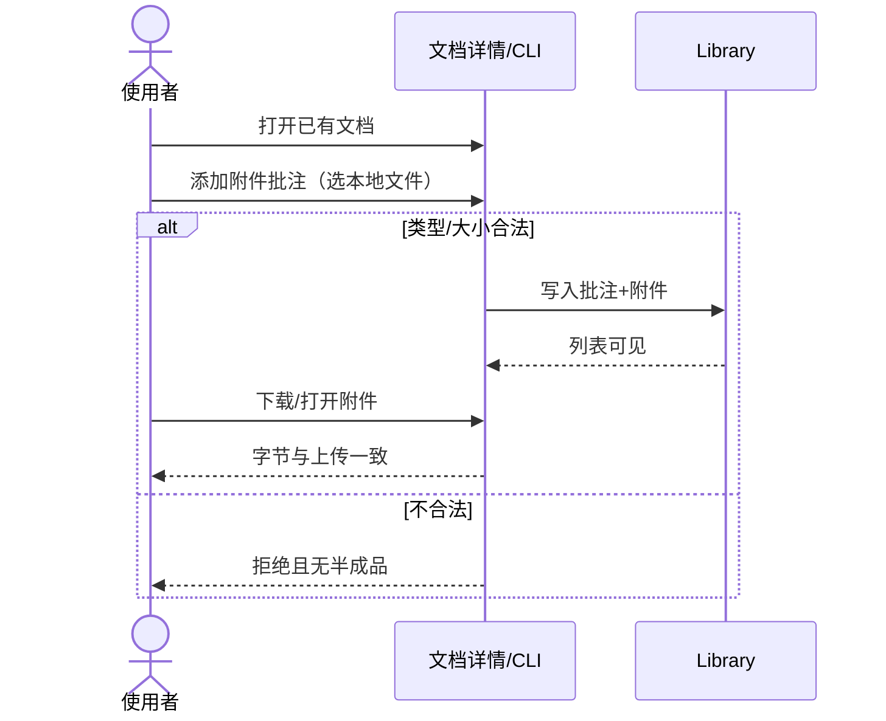

# Library 附件类型文档批注

- Issue：[#224](https://github.com/xforce-io/researcher/issues/224)
- 状态：**Approved**
- 版本：`v0.1-draft`
- 日期：2026-10-30 Asia/Shanghai
- 批准：peng via Jenny · Staff，2026-10-30 ~23:25 Asia/Shanghai。Approve L1；按 Draft 继续 L2→dev→Knox→merge。说明文字选填；附件可用于任意 `docType`（含 video/note）；类型与 25MiB 按 Draft。合入后 Palantir URL 入库 + Episode PDF 挂接不在本 agent 范围。
- 分支：`feat/224-library-attachment-comment`
- 产品确认来源：peng via Jenny · Staff 对本文 Draft 的 Approve（上条）；触发授权：peng 经 Jenny ~23:02 Asia/Shanghai 要求端到端交付「文件类型 comment / 附件 comment」并完成 Palantir PDF 入库 + Episode PDF 挂接（后两项留待合入后由后续 agent 执行）

Issue 是粗粒度验收；本文件是产品行为事实源。L1: **reuse**（Approved）。L2: **write**（[technical.md](./technical.md) Draft `v0.1-draft`）。

## 1. 背景与目标

使用者要把相关本地文件（如 PDF）钉在某条 Library 文档的批注上，而不是另开一条独立文档或只贴路径文字。目标：任意已有 Library 文档可添加、查看、取回**附件类型文档批注**；与现有文本批注共存。

## 2. 范围与非目标

**In**

- 文档级附件批注：添加、列表、下载/打开、删除
- Web 文档详情为主入口；CLI 提供等价添加与列表（便于 agent / 脚本）
- 至少支持 PDF；允许常见只读材料类型（见 R2）
- 与现有文本批注（kind=note|…）同区展示，可区分

**Out**

- 把附件升格为独立 Library 文档
- 附件深读 / Essence
- 改 Buzz；Telegram；云端对象存储
- 任意可执行二进制、无上限体积
- 批注内嵌富文本编辑附件内容
- 本期不改 Library workspace sync 传二进制的既有排除口径（附件与 video media 一样本机保留；L2 写明）

## 3. 用户与产品概念

- **角色**：Workspace 使用者（本地 Console / CLI），无多租户 ACL 本期
- **文档批注**：沿用 glossary；本期扩展为可带**一个附件**的批注条目（仍不具文档身份）
- **附件批注**：文档批注的一种呈现：必有文件名与可取回字节；可选短说明文字
- **文本批注**：既有仅 `body` 的批注，行为不变

## 4. Product Interaction Overview

## 5. 信息架构与入口

| 入口 | 行为 |
|---|---|
| Web · 文档详情 · 批注区 | 现有文本批注列表旁增加「添加附件」；每条附件批注显示文件名、大小、可选说明、下载、删除 |
| CLI | `researcher library comment attach <document-id> <file>`（名称可在 L2 微调，语义不变）；`library show` 列出附件批注元数据 |
| 空状态 | 无批注时批注区说明可添加文本或附件；不另开导航页 |

## 6. Stories 与完整交互

### S1. 为 Library 文档添加附件批注

- **角色**：使用者
- **前置**：Workspace Library 已有目标文档（任意 `docType`，含 paper）
- **入口**：Web 详情「添加附件」或 CLI `comment attach`
- **操作**：选择本地文件（可选填写说明文字）→ 提交
- **成功**：该文档批注列表出现新附件批注（文件名、大小、时间）；刷新/重开仍在
- **异常**：见 R2/R3；失败时列表不变、磁盘无孤儿附件目录残留

### S2. 查看与下载附件批注

- **角色**：使用者
- **前置**：S1 成功
- **入口**：Web 详情批注列表「下载」；或 CLI show 给出可打开的本地路径/导出
- **成功**：取回字节与上传一致（size + sha256 可核对）
- **异常**：附件文件缺失时明确「文件缺失」；批注元数据仍可见，不假装可下载

### S3. 拒绝不支持的附件

- **角色**：使用者
- **前置**：目标文档存在
- **操作**：上传超限或禁止类型
- **成功（产品失败路径）**：可见错误；不创建批注；不留半成品文件

## 7. 产品规则与边界

- **R1**：一条附件批注恰好绑定一个文件；不支持一条批注多个文件（要多个就多条批注）。
- **R2 允许类型（本期）**：`.pdf` 必支持；另允许 `.txt` `.md` `.png` `.jpg` `.jpeg` `.webp`。其它扩展名拒绝。
- **R3 大小**：单文件 ≤ **25 MiB**。超额拒绝。
- **R4**：删除附件批注时同时去掉其附件文件；删除文档时级联去掉其全部批注与附件（与现有批注删除/文档删除一致的用户预期）。
- **R5**：文本批注 API/UI 保持兼容；不能因本期改动而无法只发文本。
- **R6**：附件批注可选说明文字；无说明时列表仍以文件名为主展示。

## 8. 验收与效果验证（L1.8）

主 verify 功能文件：`.agents/skills/verify-researcher/features/document-detail.md`（L2 可增补 CLI 条目）。

| ID / 关联 | 前置 | 路径 | 结果与禁止行为 | 证据 / 执行 / 属性 |
|---|---|---|---|---|
| S1.A1 / S1 / R1–R3 | Library 有一文档；本机有 ≤25MiB PDF | Web 详情→添加附件→选 PDF→提交→刷新 | 列表出现该附件批注；禁止无列表项却已占磁盘半成品 | 详情截图或 DOM/API 列表 + 附件路径存在；agent+人工；必需 |
| S1.A2 / S1 | 同 S1.A1 | CLI attach 同一 PDF 到另一文档（或同文档第二条） | CLI 成功退出；show/详情可见 | CLI 输出 + show；agent；必需 |
| S2.A1 / S2 / R1 | S1.A1 完成 | 详情下载（或 CLI 导出路径读字节） | sha256/size 与源文件一致 | hash 对比记录；agent；必需 |
| S2.A2 / S2 | 人为移走附件文件，元数据仍在 | 详情点下载 | 明确缺失错误；不返回空 200 冒充成功 | 错误文案/状态码记录；agent；必需 |
| S3.A1 / S3 / R2 | 目标文档存在 | 上传 `.exe` 或未列扩展名 | 拒绝；批注数不变；无新附件文件 | 前后 list + 目录 listing；agent；必需 |
| S3.A2 / S3 / R3 | 目标文档存在 | 上传 >25MiB 且扩展名合法的文件 | 同 S3.A1 | 同上；agent；必需 |

## 9. 折衷与开放问题

**已选（请 Approve 时一并确认）**

- 附件是批注的扩展，不是新文档类型
- 类型与 25MiB 上限如上，避免无界上传
- Web + CLI 双入口

**开放（Approve 已按 Draft 默认确认，不改范围）**

- O1：说明文字是否必填？默认**选填**（已确认）
- O2：是否允许对 `docType=video` / `note` 添加附件批注？默认**允许**（任何文档）（已确认）

无影响主路径的未决项留给 L2 的：磁盘目录命名、mutationId 幂等、sync 排除清单措辞。
