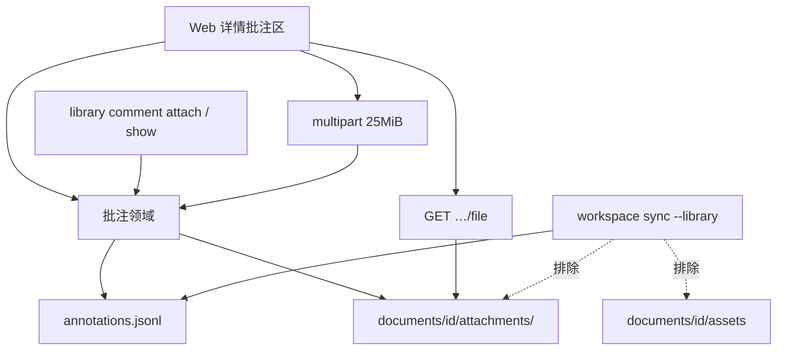

# L2：Library 附件类型文档批注

- Issue：[#224](https://github.com/xforce-io/researcher/issues/224)
- 层级：**L2**
- 状态：**Draft**（待 peng Approve；本文不自批）
- 版本：`v0.1-draft`
- 日期：2026-10-30 Asia/Shanghai
- 分支：`feat/224-library-attachment-comment`
- L1：[`product.md`](./product.md) 版本 `v0.1-draft` 状态 **Approved**（peng via Jenny · Staff，2026-10-30 ~23:25 Asia/Shanghai）
- 现有机制：[how.md](./how.md)；`src/library/model.ts` `PaperNote`；`src/library/store.ts` `annotations.jsonl` / `createVideo`；`src/web/server.ts` annotations CRUD；`src/web/multipart.ts` 视频入库

本文只钉实现边界，不改已批 L1 契约。L1: **reuse**（Approved）。L2: **write**（本文）。

## L2.1 实现策略与范围

沿用文档批注账本，不新造文档类型。一条附件批注仍是 `annotations.jsonl` 里的人类记录，额外挂**恰好一个文件**的元数据；字节落在该文档目录下、与视频 `assets/media.*` **分家**的附件子树。Web 详情与 CLI 等价写入/列举；Library sync 继续排除二进制（与 video media 同一口径）。

**做**

- 扩展 `PaperNote` / `AnnotationRecord`：可选 `attachment` + 可选 `mutationId`；缺字段的旧文本行仍合法。
- 任意已有 Library 文档（含 `note` / `video` 及全部外部材料类型）可添加、列出、下载、删除附件批注。
- 文本批注 JSON POST（仅 `body`/`kind`/`pinned`）保持可写。
- Web 批注区增加「添加附件」；CLI `library comment attach` + `library show` 列出附件元数据（含可打开的本机路径）。

**不做（L1 Out，实现不得顺手做）**

- 把附件升格为独立 Library 文档；附件深读 / Essence；改 Buzz / Telegram / 云对象存储。
- 一条批注多个文件；任意可执行二进制；放宽 25MiB。
- 改 Library sync 白名单去传附件字节。
- Palantir URL 入库与 Episode PDF 挂接（合入后由后续 agent 执行）。

**修订既有设计中「note/video 无批注」的非目标**（仅批注写入与展示，其它动作不变）

| 旧约束 | 本票 |
|---|---|
| #186 / #191 / #197 / #207：note/video 的 annotations 为 422，详情无批注区 | 解除 **annotations** 的类型门禁；详情增加批注区。`reads` / 文档 DELETE 对 note/video 仍 422 |
| #207：note/video 无「文档批注」入口，且不得两个实心主按钮 | 批注区进入 note/video；头部若加跳转必须是描边，主按钮仍是「编辑笔记」/「视频分析」 |

## L2.2 数据 / 状态契约

Schema 仍为 version **2**，不升主版本。批注身份仍是 `note_<UUID>`（与现网 POST 一致），不引入第二种 ID 前缀。

### 账本行

`PaperNote` / `annotations.jsonl` 在现有字段上**加法**：

```ts
type PaperNoteKind = 'note' | 'clarification' | 'caveat' | 'idea' | 'question';

interface AnnotationAttachment {
  filename: string;      // 用户可见原名（basename，可含空格；不含路径分隔）
  storedName: string;    // 目录内实际文件名（安全化后的 basename + 扩展名）
  contentType: AnnotationContentType;
  bytes: number;         // 落盘后的字节数
  sha256: string;        // 小写 hex
}

type AnnotationContentType =
  | 'application/pdf'
  | 'text/plain'
  | 'text/markdown'
  | 'image/png'
  | 'image/jpeg'
  | 'image/webp';

interface PaperNote {
  id: string;
  paperId: string;       // 运行时字段名沿用；jsonl 键仍是 documentId
  body: string;          // 文本批注必填 trim 后非空；附件批注可为 ""（选填说明）
  kind: PaperNoteKind;
  pinned: boolean;
  attachment?: AnnotationAttachment; // 缺省 = 文本批注
  mutationId?: string;   // 仅附件创建幂等；旧文本行无此字段
  createdAt: string;
  updatedAt: string;
}
```

jsonl 一行示例（附件）：

```json
{
  "id": "note_…",
  "documentId": "doc_…",
  "body": "Episode 材料",
  "kind": "note",
  "pinned": false,
  "attachment": {
    "filename": "Episode.pdf",
    "storedName": "Episode.pdf",
    "contentType": "application/pdf",
    "bytes": 1048576,
    "sha256": "…"
  },
  "mutationId": "mut_…",
  "createdAt": "…",
  "updatedAt": "…"
}
```

**判定**

- **文本批注**：无 `attachment`。`body` trim 后必须非空（现网不变）。
- **附件批注**：有 `attachment`。`body` 为可选说明，trim 后可空。展示以 `filename` 为主，有说明则同条显示。
- 不新增 `kind=attachment`。列表用「有无 attachment」区分，kind 仍走现有中文标签。
- 读入时忽略未知字段；缺 `attachment` 不得当成损坏行丢弃。
- 一条批注恰好一个文件（L1 R1）。禁止两条批注 jsonl 指向同一 `storedName` 路径；禁止一条元数据引用另一条的文件。
- 同一文件重复添加 = 两条独立批注（与 video 入库不去重指纹一致）。只靠 `mutationId` 去重同一次提交的重试。

`paperId` 作为 TypeScript 字段名沿用，避免大面积改调用方；磁盘与 HTTP JSON 对外一律 `documentId`（现网 annotations GET 已如此）。

### 磁盘布局

视频媒体继续独占：

```text
documents/<documentId>/assets/media.mp4 | media.webm
documents/<documentId>/assets/source.pdf   # 迁移来的论文源文件，本票不改
```

附件批注用**兄弟目录**，避免与 `media.*` / `source.pdf` 抢名：

```text
.researcher-workspace/library/
  annotations.jsonl
  documents/<documentId>/
    document.md
    attachments/<annotationId>/<storedName>
```

`storedName` 由服务端从原 filename 得到：只取 basename、拒绝 `..` 与路径分隔，保留允许的扩展名；若安全化后为空则用 `file` + 扩展名。目录名等于批注 `id`，删除一条即 `rm` 该目录。

临时上传写在 `.researcher-workspace/tmp/`（与视频 multipart 相同），成功或失败后都删临时文件。临时文件不是资源，不得被 list/download。

### 生命周期

| 事件 | 账本 | 字节 |
|---|---|---|
| 添加成功 | 追加/upsert 一行含 `attachment` | `attachments/<id>/<storedName>` 已就位后才算成功 |
| 添加失败（类型/大小/校验/写盘） | 不出现该行 | 不留 `attachments/<id>/`，tmp 清掉 |
| 删除该批注 | 从 jsonl 去掉该行 | 删除 `attachments/<annotationId>/` |
| 删除文档（现有级联） | 去掉该 `documentId` 的全部批注行 | `rmSync(documents/<id>)` 已含 attachments |
| 字节被人为移走 | 元数据仍在 | 下载/打开明确缺失，不返回空 200 |

发布顺序（失败即停，不宣称成功）：校验类型与大小 → 领域写锁内复制到最终路径 → 计算 sha256/bytes → 写入 jsonl。jsonl 失败则删除刚写入的附件目录。禁止先写 jsonl 再拷文件（S2 会把缺失当成已成功条目的下载）。

### 幂等

附件创建接受 `mutationId`（Web 必填，与视频入库一致；CLI 未传则服务端生成一次，不把「没传」当空字符串去重）。

同一 `documentId` 上已有批注 `mutationId` 相同：

- 附件 sha256、bytes、filename、caption（`body`）均相同 → 返回该条，不复制文件、不新增行。
- 任一字段不同 → 409，列表与磁盘不变。

文本批注 POST 仍每次新 `note_<UUID>`，不引入 mutationId（R5）。

## L2.3 模块与责任



| 边界 | 责任 |
|---|---|
| `src/library/model.ts` | `AnnotationAttachment` 与 `PaperNote.attachment` |
| `src/library/attachment.ts`（新，或与 `video.ts` 并列的纯函数） | 扩展名 / MIME / 25MiB 校验；安全文件名；常量 `ATTACHMENT_MAX_BYTES` |
| `src/library/store.ts` | `upsertNote` 允许附件时空 body；创建/删除附件的锁、路径、级联；`attachmentPath`；缺文件可查询但不可冒充存在 |
| `src/web/multipart.ts` | 附件 multipart 读取，上限 25MiB（**不得**复用 `VIDEO_MAX_BYTES`） |
| `src/web/server.ts` | 文本 JSON 与附件 multipart 分路径；下载；note/video 不再对 annotations 返回 422 |
| `src/web/views.ts` | 四类详情批注区：文本表单保留；增加添加附件；列表区分附件条；空态文案 |
| `src/commands/library.ts` / `src/cli.ts` | `comment attach`；`show` 列出附件元数据与本机路径 |
| `src/workspace/sync.ts` | 白名单不增加 `attachments/`；`annotations.jsonl` 已在白名单，元数据随 sync |

不要求按表新建包名；`attachment.ts` 与 `video.ts` 同级是为了不把 PDF 校验塞进视频模块。函数命名归实现 PR。

`noteActionBlocked` 今日把 note/video 的 DELETE、reads、annotations 绑在一起。本票必须拆开：annotations 对任意存在的文档放行；reads 与文档 DELETE 维持现网 422。禁止为了放行批注而放行深读或删除。

## L2.4 API / CLI

沿用 documents 根。GET 页面 HTML；资源 `Accept: application/json` 为 JSON。写请求同源规则不变。

### HTTP

| 方法与路径 | 契约 |
|---|---|
| GET `/library/documents/:documentId/annotations` | 任意 `docType`（文档须存在）。每项含现有字段；有附件时多 `attachment`（filename/contentType/bytes/sha256，**不含**磁盘绝对路径）。无附件的旧项不得带空对象冒充附件。note/video **200**，不再 422 |
| POST `/library/documents/:documentId/annotations` | **仅** `Content-Type: application/json`。现网文本创建：`body` 必填 trim 非空，`kind`/`pinned` 可选。201 `{ id, url }`。禁止用 JSON 传文件或 base64 |
| POST `/library/documents/:documentId/annotations/attachments` | **仅** multipart（或与视频入库相同的 raw + `x-filename` / `x-mutation-id`，二选一须在实现里只保留一种对外契约；推荐 multipart，字段见下）。成功 201 `{ id, url }`，url 仍指向 `#annotations`。失败不建行、不留目录 |
| GET `/library/documents/:documentId/annotations/:annotationId` | 可选；若实现，返回该条 JSON（含 attachment 元数据，不跟字节） |
| GET `/library/documents/:documentId/annotations/:annotationId/file` | 附件字节。`Content-Type` 为存储的 MIME；`Content-Disposition: attachment; filename="…"` 用原 `filename`。元数据无 attachment → 404 `not_found`。文件缺失 → **409** `attachment_missing`（或 404 但 **code 必须是** `attachment_missing`），**禁止** 200 空 body。不要求 Range |
| PATCH `/library/documents/:documentId/annotations/:annotationId` | 现网钉选。附件批注可钉选，不改文件 |
| DELETE `/library/documents/:documentId/annotations/:annotationId` | 204；去掉 jsonl 行并删除对应 attachments 目录。文本批注行为不变 |

附件 POST multipart 字段：

| 字段 | 必填 | 含义 |
|---|---|---|
| `file` | 是 | 文件部分，带 filename |
| `mutationId` | 是 | 幂等键 |
| `caption` 或 `body` | 否 | 说明文字；实现认一个主名 `caption`，可把 `body` 当别名，但不得两个都有且不一致 |
| `kind` | 否 | 默认 `note` |
| `pinned` | 否 | 默认 false |

校验顺序：文档存在 → 有 file → 大小 → 扩展名 → MIME → 写入。任一步失败用 L2.6 的 code，不写半成品。

列表排序仍是 pinned 优先、再 `updatedAt` 降序、再 id。附件与文本同一列表。

### Web 详情

paper / blog：现有 `#annotations` 区增加「添加附件」（文件选择 + 可选说明 + 提交）。提交中禁用重复提交。成功后列表出现该条（文件名、人类可读大小、时间、可选说明、下载、删除）；刷新仍在。文本「添加批注」表单与 `required` body 不变。

空态改为可添加文本或附件（L1 §5），例如「尚无文档批注，可添加文本或附件。」不得另开导航页。

note / video：在主阅读面（笔记正文 / 视频工作台）**下方**挂同一批注区与 `#annotations` 锚点。页内偏移沿用 #207（标题不被顶栏挡住）。头部主按钮不变；若加「文档批注」跳转，必须是描边次操作。视频工作台双栏与 #200 首屏可见不因批注区被挤没——批注在工作台之下随页滚动，不塞进台词栏。

下载：每条附件批注一个下载入口，打 `…/file`。缺失时页面内联错误（映射 `attachment_missing`），不 `alert` 成功、不打开空白页装成已下载。

删除：沿用现网确认文案，删元数据与文件。

### CLI

名称按 L1，不改语义：

```text
researcher library comment attach <document-id> <file> [--caption <text>] [--kind <kind>]
```

- 成功：exit 0；stdout 一行可判定（至少 annotation id；建议再打 `filename` 与落盘路径）。
- 文档不存在 / 类型或大小不合法 / 读源文件失败：非 0；stderr 英文原因；不写 jsonl、不留附件目录。
- 未传 `--caption` 视为无说明。
- `kind` 默认 `note`。
- 不把源路径字符串写进 `body` 冒充附件。

```text
researcher library show <document-id> [--json]
```

- 文本模式：现有文档行之后，列出该文档批注。附件行必须含 filename、bytes、sha256、本机路径；文件缺失时路径处标明 missing，不得假装可打开。
- `--json`：在现有文档对象上**增加** `annotations` 数组（每项与 Web GET 同形，另可加 `path` 或 `missing: true` 供本机打开）。不得删除或改名现有文档字段。无批注时 `annotations: []`。

不新增 `comment list` / `comment export`；show 已覆盖 S2 的 CLI 入口。不把附件字节打到 stdout。

## L2.5 限制（类型、体积、路径）

常量：`ATTACHMENT_MAX_BYTES = 25 * 1024 * 1024`（25 MiB，按 1024）。`bytes === 0` 拒绝。

允许扩展名与 MIME（大小写不敏感；`.jpeg` 与 `.jpg` 都允许）：

| 扩展名 | 存储 / 返回的 contentType |
|---|---|
| `.pdf` | `application/pdf` |
| `.txt` | `text/plain` |
| `.md` | `text/markdown` |
| `.png` | `image/png` |
| `.jpg` `.jpeg` | `image/jpeg` |
| `.webp` | `image/webp` |

其它扩展名一律拒绝（L1 R2），包括 `.exe`、无扩展名、双重扩展名只认最后一段（`foo.pdf.exe` 拒绝）。

**扩展名是准入条件。** Content-Type 若缺省、空、或 `application/octet-stream`，按扩展名推断。若客户端给出具体 MIME，必须落在上表该扩展名对应值，否则拒绝——禁止 `.exe` 声称 `application/pdf` 过关。不嗅探魔数放行未列扩展名（fail-fast，避免「看起来像 PDF」的无界格式）。

路径：只在 `documents/<safeId>/attachments/<safeId>/` 下读写；`isSafeLibraryId` 约束 documentId 与 annotationId。拒绝符号链接作为最终存储（复制字节，不保留 link）。下载不得接受任意相对路径查询参数。

不把附件当视频恢复：没有「按 sha256 写回缺失附件」的产品入口；缺失就是缺失（S2.A2）。

## L2.6 错误契约

HTTP 错误体沿用 `{ code, message }`，`message` 英文（与现网 annotations 一致）。页面把 code 映成中文。CLI stderr 英文，exit 1（用法错误 2，若现网 library 子命令已有此惯例则跟随）。

| 情况 | HTTP | code | 磁盘 |
|---|---|---|---|
| 文档不存在 | 404 | `not_found` | 不变 |
| JSON 文本 POST 缺 body | 400 | `invalid_fields` | 不变 |
| 附件 POST 缺 file | 400 | `invalid_fields` | 不变 |
| 扩展名/MIME 不在允许表 | 400 | `unsupported_type` | 不变 |
| 体积 > 25MiB 或 Content-Length 已超 | 413 | `payload_too_large` | 不变；读入侧在超限时断开 |
| 空文件 | 400 | `invalid_fields` | 不变 |
| 缺 mutationId（Web 附件） | 400 | `invalid_fields` | 不变 |
| 同 mutationId 不同内容 | 409 | `mutation_conflict` | 不变 |
| 批注不存在或 documentId 不匹配 | 404 | `not_found` | 不变 |
| 元数据在、文件不在（下载） | 409（或 404，但 code 固定） | `attachment_missing` | 不补文件 |
| 跨源写 | 403 | `forbidden_origin` | 不变 |
| JSON POST 用 multipart 或附件 POST 用 JSON | 415 | `unsupported_media_type` | 不变 |
| note/video 调 **reads** / 文档 DELETE | 422 | `unsupported_action` | 现网 |
| note/video 调 **annotations** | 不得 422 | — | — |
| 写盘失败 | 500 | `save_failed` | 无新行、无新附件目录 |

S3 产品失败路径：可见错误 + 批注条数不变 + 无新附件文件。实现用「操作前后 listNotes 长度 + attachments 目录 listing」可测，不靠 UI 文案模糊匹配当唯一断言。

## L2.7 迁移 / 兼容 / Library sync

**文本批注继续有效。** 旧 `annotations.jsonl` 行只有 `id/documentId/body/kind/pinned/createdAt/updatedAt` 时：`listNotes` / GET / 详情渲染 / 钉选 / 删除必须与本票之前相同。禁止因缺 `attachment` 跳过或抛错。`upsertNote` 对无附件且 body 为空仍拒绝。

无资料迁移命令。已有 workspace 不改 schema.json。首次写入附件时创建 `attachments/` 即可。

Library sync（#173 / #186 / #191）白名单**不增加** `documents/*/attachments/**`。结果：

- `annotations.jsonl` 继续进 git（含 attachment 元数据）。
- 附件字节与 `assets/` 一样本机保留，clone 后可出现 S2.A2 式缺失——这是规定行为，不是 bug。
- `isAllowlistedLibraryPath` 不得把 `attachments` 认成 `reads` 或 `analyses`。

回滚程序：停写附件后恢复旧二进制。旧程序忽略 jsonl 多余字段，文本批注仍可读；`attachments/` 成为未引用文件，不自动删除。glossary「文档批注」现写「本期用于已有外部材料」——实现 PR 须改成依附任意 Library 文档，禁止别称仍是「论文批注」。

`library show --json` 增加 `annotations` 键，属可加字段；不改 `id`/`docType`/`title` 等现有键。

## L2.8 验收映射（L1.8 → verify features）

不新建 `library-attachment.md`。#224 的用户入口落在现有文档详情地图；CLI 按 L1 写进同一文件，不占用 `papers-cli.md`（那是 `papers trending/search/show/read`）。

| L1.8 | Story | 功能文件 | 入口 | 本票动作 |
|---|---|---|---|---|
| S1.A1 | S1 | [document-detail.md](../../../.agents/skills/verify-researcher/features/document-detail.md) | Web 详情 → 添加附件 → 选 ≤25MiB PDF → 提交 → 刷新 | **更新**：增 `#224 S1–S3` 节 |
| S1.A2 | S1 | 同上 | CLI `library comment attach` 同一 PDF 到另一文档或同文档第二条；`library show` | **更新**：同一节写 CLI 入口，不新建 CLI 功能文件 |
| S2.A1 | S2 | 同上 | 详情下载（或 CLI 给出的路径读字节），sha256/size 与源文件一致 | 写入该节 |
| S2.A2 | S2 | 同上 | 人为移走附件文件后点下载；明确缺失；不空 200 | 写入该节 |
| S3.A1 | S3 | 同上 | 上传 `.exe` 或未列扩展名；拒绝；条数不变；无新文件 | 写入该节 |
| S3.A2 | S3 | 同上 | 上传 >25MiB 且扩展名合法；同 S3.A1 | 写入该节 |

Drive 本票时打开 `document-detail.md`。会碰到的已 pass 功能（四类详情、topic 面板、视频工作台）仍要保全：#207 S2 不得两个实心主按钮；#200 播放器与台词首屏可见。#207 S1 原文「note、video 无批注入口」**不再作为本票通过条件**——#224 起 note/video 有批注区；该历史句在功能文件里加一句指向本票，避免验 #224 时被旧禁止项误杀。

隔离 workspace：至少一份 paper（或 blog）作 S1.A1 主路径；S1.A2 可用另一文档（建议 video 或 note，锁 O2）。PDF 夹具 ≤25MiB；超限夹具用稀疏/截断文件即可，禁止用巨大实片拖垮门禁。`.exe` 用最小假文件。

证据目录 `.grok/verify-runs/224/`（不进 git）：doctor.txt、详情截图、GET annotations JSON、sha256 对比、拒绝前后 listing、CLI stdout/stderr。

## L2.9 测试分层

层级仅 Unit / Integration / E2E（keel-verify 走 L2.8）。默认 `npm test` 不打 live Palantir、不依赖日常 `:4500`。

**Unit**

- 允许表：六类扩展名过；`.exe`、无扩展名、`foo.pdf.exe` 拒。
- 25MiB 边界：等于上限过，+1 字节拒。
- 旧 jsonl 行无 `attachment` → `recordToNote` 仍是文本批注。
- 安全文件名：路径分隔与 `..` 被剥掉。

**Integration**

- store：文本 `upsertNote` 仍拒空 body；附件允许空 caption；删除批注去掉目录；`deletePaper` 级联去掉 jsonl 与 `attachments/`。
- HTTP：paper JSON POST 文本 201；multipart PDF 201 且文件存在；note/video annotations GET/附件 POST 不是 422；`.exe` 400 且目录 listing 不变；>25MiB 413；下载 sha256 一致；缺文件 `attachment_missing`。
- CLI：`comment attach` 成功后 `show` 含 filename/bytes/path。
- sync：`annotations.jsonl` 进 `git ls-files`；`attachments/` 下文件不进。

**E2E**

即 L2.8 表。Web 与 CLI 两条入口都要走；只打 API 或只点按钮算未完成。

## L2.10 折衷（已锁定）与开放问题

**已锁定（无需再问 peng）**

- 附件是批注扩展，不是新 `docType`。
- 磁盘用 `documents/<id>/attachments/<annotationId>/`，不用 `assets/`：`assets/media.*` 已是视频契约，混放会把删除/sync/恢复纠在一起。
- 不做跨批注文件去重；mutationId 只服务同一次提交重试。
- sync 排除附件字节，元数据进 git。
- 文本与附件 POST 分路径（JSON vs multipart），避免 25MiB 走现网 2MiB `readBody`。

**开放（不阻塞实现）**

无。O1/O2 已随 L1 Approve 按 Draft 默认确认。caption 长度不另设上限（远小于 25MiB 文件）；若实现要 trim 到与现有 textarea 一致即可，不必新配置键。
